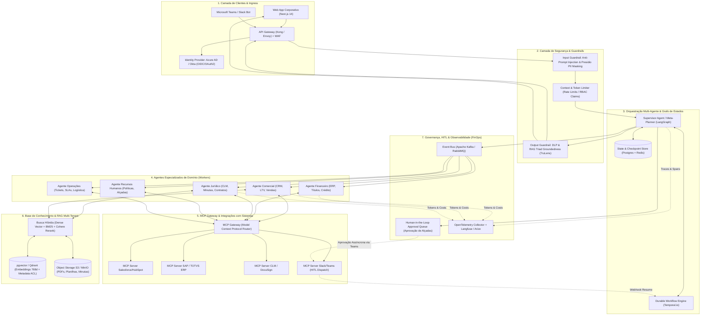

# 🏛️ System Design & Arquitetura Multi-Agents de IA Corporativa
## Plataforma de Inteligência Artificial para 5.000+ Colaboradores

---

## 1. Visão Executiva e Topologia da Solução

Para suportar uma organização com 5.000 colaboradores e múltiplos departamentos altamente regulados e heterogêneos (Financeiro, Jurídico, Comercial, RH e Operações), a arquitetura adota o padrão **Hierarchical Multi-Agent Graph (Supervisor-Worker Pattern)** combinado com **Event-Driven Microservices** e o padrão aberto **Model Context Protocol (MCP)**.

### Diagrama End-to-End da Arquitetura



---

## 2. Resolução do Caso de Uso Prático (Cliente XPTO)

> **Solicitação do Usuário:**
> *"Preciso preparar a renovação do contrato do cliente XPTO. Verifique o histórico comercial, identifique possíveis pendências financeiras, consulte as cláusulas contratuais vigentes e avalie se podemos oferecer um desconto de 10%. Caso seja viável, gere uma proposta comercial atualizada e encaminhe para aprovação do responsável."*

### Sequência de Execução Multi-Agente & HITL

```mermaid
sequenceDiagram
    autonumber
    actor Colaborador as Colaborador (Comercial)
    participant Gateway as API Gateway & Guardrails
    participant Supervisor as Supervisor (LangGraph)
    participant AgCom as Agente Comercial
    participant AgFin as Agente Financeiro
    participant AgJur as Agente Jurídico
    participant MCP as MCP Gateway
    participant HITL as Human-in-the-Loop (Diretor)
    participant DocGen as Agente Gerador de Proposta

    Colaborador->>Gateway: Submete solicitação em linguagem natural
    Gateway->>Gateway: Valida JWT, faz Sanitização & Mascara PII
    Gateway->>Supervisor: Inicia Workflow (Sessão cId: 8f9a-...)
    
    rect rgb(20, 30, 50)
        Note over Supervisor,AgJur: FASE 1: Coleta Paralela de Evidências (Cross-Domain)
        par Consulta Comercial
            Supervisor->>AgCom: Tarefa A: Extrair histórico e LTV do XPTO
            AgCom->>MCP: Call Tool `salesforce_get_customer_history(id: XPTO)`
            MCP-->>AgCom: Histórico: 3 anos de contrato, R$ 1.2M LTV, churn risk baixo
            AgCom-->>Supervisor: Fato: Cliente Tier 1, margem média 32%
        and Consulta Financeira
            Supervisor->>AgFin: Tarefa B: Verificar pendências financeiras no ERP
            AgFin->>MCP: Call Tool `sap_get_aging_report(cnpj: XPTO)`
            MCP-->>AgFin: Status: 0 títulos vencidos, histórico pontual
            AgFin-->>Supervisor: Fato: Adimplente, limite de crédito aprovado
        and Consulta Jurídica (RAG Contratual)
            Supervisor->>AgJur: Tarefa C: Consultar cláusulas de renovação e reajuste
            AgJur->>MCP: RAG Search: `contratos_xpto_vigente.pdf` (ACL: Jurídico/Comercial)
            MCP-->>AgJur: Cláusula 8.2: Permite desconto até 12% mediante alçada diretoria
            AgJur-->>Supervisor: Fato: Vigência encerra em 30 dias; reajuste IPCA acumulado 4.2%
        end
    end

    rect rgb(30, 45, 30)
        Note over Supervisor,AgCom: FASE 2: Avaliação de Viabilidade do Desconto
        Supervisor->>AgCom: Avaliar viabilidade de desconto de 10%
        AgCom->>AgCom: Simulação de Margem (32% - 10% = 22% > Margem mínima corporativa 18%)
        AgCom-->>Supervisor: Parecer: Viável financeiramente e permitido pela cláusula 8.2
    end

    rect rgb(50, 30, 40)
        Note over Supervisor,HITL: FASE 3: Geração de Minuta & Human-in-the-Loop (HITL)
        Supervisor->>DocGen: Gerar minuta PDF da proposta com desconto de 10%
        DocGen->>MCP: Call Tool `clm_create_draft_proposal(...)`
        MCP-->>DocGen: Proposta #PROP-2026-992 gerada
        DocGen-->>Supervisor: Documento pronto para assinatura

        Supervisor->>HITL: Suspende Grafo (Status: WAITING_DIRECTOR_APPROVAL)
        Supervisor->>MCP: Dispatch Adaptive Card no Microsoft Teams para o Diretor Comercial
        Note over HITL: Diretor recebe no Teams com resumo, métricas e botões [Aprovar] / [Rejeitar]
        HITL->>MCP: Clica em [Aprovar Proposta com 10%]
        MCP->>Supervisor: Webhook Callback (Aprovação autenticada com ID do Diretor)
        Supervisor->>Supervisor: Descongela Grafo & Registra Carimbo de Auditoria
    end

    Supervisor->>Gateway: Resposta final consolidada + Link da Proposta Aprovada
    Gateway->>Colaborador: "Renovação preparada com sucesso! O histórico comercial e financeiro está positivo..."
```

---

## 3. As 8 Decisões de Engenharia & Arquitetura

### 1. Multi-Agents: Topologia e Protocolos de Comunicação
* **Padrão Adotado**: **Hierarchical Supervisor com Grafo de Estados (LangGraph)**.
  - O agente *Supervisor* recebe a intenção do usuário, gera um plano de execução em formato DAG (Grafo Acíclico Dirigido), identifica quais nós possuem independência de dados para disparar em **paralelo** (via `asyncio.gather` ou eventos Kafka) e quais nós dependem dos resultados anteriores para rodar em **sequência**.
* **Protocolo de Mensageria Interna**:
  - Comunicação síncrona/streaming: **gRPC** com Protobuf entre serviços internos para máxima eficiência e tipagem estrita.
  - Comunicação assíncrona/decupada: **Apache Kafka** para eventos de longa duração, permitindo que cada agente seja um microsserviço escalável individualmente.

### 2. RAG Corporativo Multi-Tenant com RBAC/ABAC
* **Ingestão e Particionamento**:
  - Chunking semântico estruturado respeitando capítulos, artigos e seções.
  - Cada chunk indexado no banco vetorial (`pgvector` ou `Qdrant`) recebe metadados de controle de acesso:
    ```json
    {
      "chunk_id": "c-9482",
      "document_id": "contrato-xpto-2025.pdf",
      "allowed_departments": ["Comercial", "Juridico", "Diretoria"],
      "security_clearance": "Confidencial",
      "client_id": "XPTO-SA"
    }
    ```
* **Busca Híbrida e Filtragem no Recuperador**:
  - Combinação de **Similaridade Semântica de Cosseno (Dense)** com **Busca Lexical BM25 (Sparse)** e **Re-ranking Cohere/BGE**.
  - **Injeção de Contexto de Segurança (Pre-retrieval Security Injection)**: O recuperador intercepta a query e injeta cláusulas `WHERE` obrigatórias derivadas das claims do token JWT do colaborador. Se um operador do Financeiro consultar contratos jurídicos sem alçada, o vetor filtra antes de qualquer cálculo de similaridade, impossibilitando vazamento de dados corporativos.

### 3. Integração via MCP (Model Context Protocol)
* **Por que MCP e não Function Calling proprietário?**
  - O **Model Context Protocol (MCP)**, padronizado pela Anthropic e adotado pela indústria, estabelece um protocolo cliente-servidor JSON-RPC neutro em relação a provedores de LLM.
  - Cada sistema corporativo (SAP, Salesforce, Jira, Legados SQL) ganha um **Servidor MCP dedicado**.
  - Os servidores MCP expõem:
    1. *Tools* tipadas via JSON Schema com validação estrita.
    2. *Resources* (documentos e logs mapeados como URIs como `salesforce://customers/XPTO`).
    3. *Prompts* pré-homologados pelos donos dos sistemas.
  - **Tool-Level Authorization**: Quando o Agente Comercial solicita `salesforce_create_opportunity`, o gateway MCP valida se o usuário autenticado na sessão possui a permissão correspondente no Salesforce antes de invocar a API de escrita.

### 4. Guardrails & Camada de Confiança (Trust & Safety)
* **Input Guardrails**:
  - **Detector de Injeção de Prompt**: Modelo classificador leve (ex: Llama Guard / NeMo Guardrails) treinado para identificar tentativas de bypass de instruções de sistema e vazamento de prompt.
  - **Anonimizador / PII Masking (Microsoft Presidio)**: CPF, CNPJ, cartões de crédito e dados sensíveis são mascarados em memória antes do envio a provedores de LLM externos (ex: `123.456.789-00` vira `<CPF_ANON_1>`), sendo desmascarados apenas no retorno local para o usuário com acesso.
* **Output Guardrails**:
  - **RAG Triad & Groundedness**: Avaliação em tempo real se as afirmações da resposta possuem embasamento estrito nos chunks recuperados (prevenção absoluta de alucinação).
  - **Data Loss Prevention (DLP)**: Bloqueio automático de chaves de API, senhas ou segredos industriais no payload de retorno.

### 5. Human-in-the-Loop (HITL) para Decisões Críticas
* **Congelamento de Estado (State Suspension)**:
  - Operações de alçada comercial (descontos acima de 5%, rescisões contratuais, baixa de títulos vultosos) não são finalizadas autonomamente pelos agentes.
  - O motor de workflow (Temporal.io + LangGraph Checkpointer) transiciona a execução para `SUSPENDED_AWAITING_APPROVAL`, gerando um ID de aprovação criptografado com TTL de 48 horas.
* **Disparo Interativo & Resunção**:
  - O sistema envia um Card Interativo (Adaptive Card no Teams ou Slack Block Kit) para o canal privado do Diretor Responsável com resumo analítico, dados dos três agentes e botões de ação.
  - O clique do gestor bate em um endpoint de Webhook com mTLS, valida a assinatura digital e emite o sinal de desdobramento (`SignalWorkflow`) no Temporal, fazendo o agente prosseguir imediatamente para a fase de emissão e envio.

### 6. Memória & Estado Distribuído
* **Memória de Trabalho (Working Memory)**:
  - Redis Cluster para gerenciar o estado da sessão em andamento, buffers de streaming (SSE) e cache semântico de perguntas frequentes.
* **Memória Episódica (Episodic Memory)**:
  - PostgreSQL 16 com Drizzle ORM armazenando o histórico de conversas, passos intermediários de pensamento (Chain-of-Thought), ferramentas acionadas e feedbacks humanos.
* **Memória Semântica Corporativa**:
  - Indexação contínua de preferências do cliente e perfis corporativos consolidados em vetores de longo prazo.

### 7. Observabilidade, Rastreabilidade & FinOps
* **Tracing Distribuído de Ponta a Ponta**:
  - Instrumentação nativa com **OpenTelemetry (OTel)** e **Langfuse / Arize Phoenix**.
  - Cada requisição gera uma árvore de *Spans*:
    - `Span 1`: Ingress Gateway (Latência, IP, User ID)
    - `Span 2`: Input Guardrail (Validação de Prompt, PII check)
    - `Span 3`: Supervisor Planner (Modelo LLM, Tokens de entrada/saída)
    - `Span 4a, 4b, 4c`: Execuções paralelas dos Workers Comercial, Financeiro e Jurídico
    - `Span 5`: MCP Tool Invocation (Duração da chamada na API do SAP)
    - `Span 6`: Suspensão HITL (Tempo de espera pela ação humana)
* **FinOps e Atribuição de Custos**:
  - Monitoramento do consumo de tokens por departamento através de tags (`dept:financeiro`, `dept:comercial`). Permite estorno de custos (*showback/chargeback*) contábil dentro da organização.

### 8. Escalabilidade para 5.000 Usuários Simultâneos
* **Infraestrutura Cloud-Native**:
  - Cluster Kubernetes (EKS / GKE) com HPA (Horizontal Pod Autoscaler) baseado em métricas customizadas de fila (mensagens pendentes no Kafka) e CPU/Memória.
  - Separação entre Pods de Orquestração (I/O intensivos) e Pods de Recuperação/Embeddings.
* **Model Router & Resiliência**:
  - Gateway de LLM (LiteLLM / vLLM) com balanceamento de carga e fallbacks transparentes entre provedores (Claude 3.7 Sonnet -> Gemini 2.5/3.5 Flash -> GPT-4o) para garantir 99.9% de SLA mesmo diante de incidentes nos provedores de nuvem.

