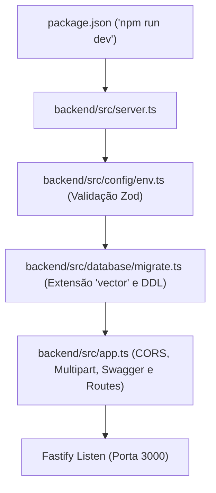
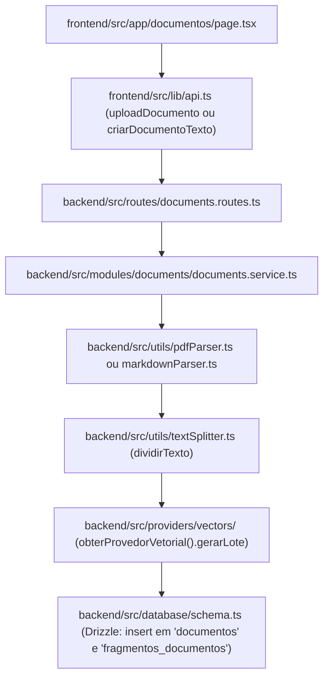
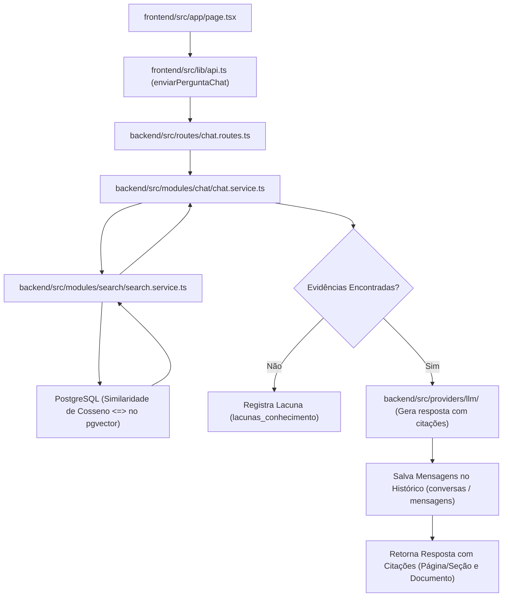
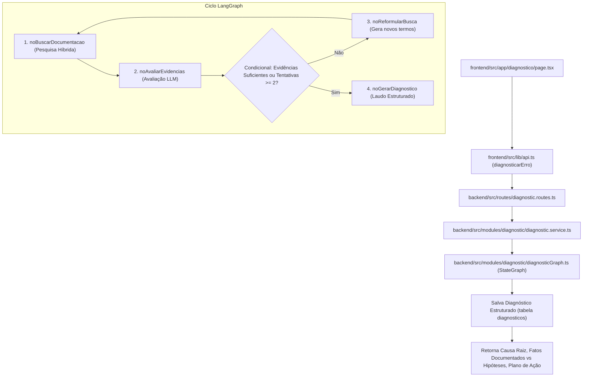

# Execution Map and Project Architecture - Doc-Mind

Este documento é o guia definitivo para entender **como cada arquivo do Doc-Mind é acessado, quem o chama, o que ele executa e como os dados fluem** entre o Frontend (Next.js 14), o Backend (Fastify), o Banco de Dados Vetorial (PostgreSQL + pgvector) e os Agentes Autônomos (LangGraph).

A arquitetura e os caminhos de arquivos seguem os padrões modernos de engenharia em TypeScript (arquitetura modular em inglês).

---

## 1. Visão Geral da Estrutura

```text
doc-mind/
├── backend/                     # API REST, RAG e Orquestração com LangGraph
│   ├── src/
│   │   ├── config/              # Validação estrita de variáveis de ambiente com Zod (env.ts)
│   │   ├── database/            # Conexão Drizzle ORM, Schemas e Migrações pgvector (index.ts, schema.ts, migrate.ts)
│   │   ├── modules/             # Regras de negócio desacopladas
│   │   │   ├── search/          # Pesquisa híbrida (Similaridade de Cosseno + Full-Text)
│   │   │   ├── chat/            # RAG conversacional com histórico e fontes
│   │   │   ├── diagnostic/      # Grafo cíclico com LangGraph para análise de erros (diagnosticGraph.ts)
│   │   │   ├── documents/       # Ingestão e pipeline de processamento de PDFs e Markdown
│   │   │   └── metrics/         # KPIs de confiabilidade e lacunas de conhecimento
│   │   ├── providers/           # Fábricas para LLM e Vetores (Gemini, OpenAI, Mock)
│   │   │   ├── llm/             # Provedores de IA Generativa
│   │   │   └── vectors/         # Provedores de Embeddings Vetoriais
│   │   ├── routes/              # Controladores HTTP Fastify (*.routes.ts)
│   │   ├── utils/               # Parsers de PDF, Markdown estruturado e chunker de texto
│   │   ├── app.ts               # Montagem de plugins, CORS, Swagger e rotas
│   │   ├── server.ts            # Ponto de entrada (Entrypoint) do servidor Node.js
│   │   └── test-api.ts          # Testes automatizados de inicialização e endpoints
│   ├── .env                     # Variáveis de ambiente do backend
│   ├── drizzle.config.ts        # Configuração do Drizzle Studio e migrações
│   ├── package.json             # Dependências e scripts do backend
│   └── tsconfig.json            # Configuração TypeScript do backend
│
├── frontend/                    # Interface Web Moderna (Next.js 14 App Router)
│   ├── src/
│   │   ├── app/                 # Páginas da aplicação
│   │   │   ├── layout.tsx       # Shell com barra lateral e status do sistema
│   │   │   ├── page.tsx         # Chat RAG interativo
│   │   │   ├── diagnostico/     # Painel de diagnóstico autônomo com LangGraph
│   │   │   ├── documentos/      # Upload, inserção de Markdown (Ctrl+V) e listagem
│   │   │   ├── busca/           # Pesquisa técnica com pontuação de relevância
│   │   │   └── metricas/        # Dashboard de KPIs e resolução de lacunas
│   │   ├── components/          # Componentes reutilizáveis (Sidebar, DocumentDetailsModal)
│   │   └── lib/
│   │       ├── api.ts           # Cliente HTTP centralizado (fetch para o backend)
│   │       └── types.ts         # Tipos TypeScript compartilhados na UI
│   ├── .env.local               # Variáveis de ambiente do frontend
│   └── package.json             # Dependências e scripts do frontend
│
├── docker/                      # Infraestrutura de banco de dados
│   └── docker-compose.yml       # PostgreSQL 16 com extensão pgvector oficial
│
└── docs/                        # Documentação técnica e arquitetural
```

---

## 2. Mapa dos Ciclos de Execução (Fluxos Ponta a Ponta)

### Fluxo 1: Inicialização do Servidor (Bootstrapping)



---

### Fluxo 2: Ingestão de Manuais Técnicos (Upload ou Ctrl+V Markdown)



---

### Fluxo 3: Chat RAG Conversacional com Citações



---

### Fluxo 4: Grafo Autônomo de Diagnóstico de Erros (LangGraph)



---

## 3. Tabela de Referência Rápida: Arquivo por Arquivo

### Backend (`backend/src/`)

| Arquivo | Responsabilidade | Quem o chama / importa? | O que ele consome? |
| :--- | :--- | :--- | :--- |
| `server.ts` | Ponto de entrada do processo Node.js; orquestra subida do banco e da API. | `npm run dev` / `node dist/server.js` | `config/env.ts`, `database/migrate.ts`, `app.ts` |
| `app.ts` | Configura Fastify, CORS, multipart para uploads, Swagger OpenAPI e rotas. | `server.ts`, `test-api.ts` | Fastify, plugins, e todas as pastas em `routes/` |
| `config/env.ts` | Valida variáveis do arquivo `.env` com Zod (PORTA, DATABASE_URL, etc.). | Toda a aplicação | `dotenv`, `zod` |
| `database/index.ts` | Cria a conexão singleton com PostgreSQL via `pg.Pool` e o client Drizzle. | Serviços de negócio e migração | `pg`, `drizzle-orm/node-postgres`, `schema.ts` |
| `database/schema.ts` | Define as tabelas e o tipo customizado `vector(768)` do Drizzle ORM. | `database/index.ts`, todos os serviços | `drizzle-orm/pg-core` |
| `database/migrate.ts` | Script idempotente de migração DDL (`CREATE EXTENSION vector`, tabelas e índices). | `server.ts`, `npm run db:migrate` | `database/index.ts`, `pg` |
| `routes/documents.routes.ts` | Endpoints REST para upload, inserção de texto e exclusão de manuais técnicos. | `app.ts` | `modules/documents/documents.service.ts` |
| `routes/chat.routes.ts` | Endpoints REST para perguntas RAG e histórico de conversas. | `app.ts` | `modules/chat/chat.service.ts` |
| `routes/search.routes.ts` | Endpoint REST para pesquisa técnica híbrida. | `app.ts` | `modules/search/search.service.ts` |
| `routes/diagnostic.routes.ts` | Endpoint REST para execução do diagnóstico autônomo. | `app.ts` | `modules/diagnostic/diagnostic.service.ts` |
| `routes/metrics.routes.ts` | Endpoints REST para visualização de KPIs e lacunas de conhecimento. | `app.ts` | `modules/metrics/metrics.service.ts` |
| `modules/documents/documents.service.ts` | Ingestão: extrai páginas de PDF ou seções de Markdown, fatia em chunks e salva vetores. | `documents.routes.ts` | `pdfParser.ts`, `markdownParser.ts`, `textSplitter.ts`, `providers/vectors` |
| `modules/chat/chat.service.ts` | Orquestração RAG conversacional: busca vetorial, verificação de lacunas e LLM. | `chat.routes.ts` | `search.service.ts`, `providers/llm`, `database/` |
| `modules/search/search.service.ts` | Motor de busca vetorial (`<=>` pgvector) e busca híbrida com normalização. | `chat.service.ts`, `diagnosticGraph.ts`, `search.routes.ts` | `database/`, `providers/vectors` |
| `modules/diagnostic/diagnostic.service.ts` | Wrapper que dispara a execução do grafo de diagnóstico e salva o histórico. | `diagnostic.routes.ts` | `diagnosticGraph.ts`, `database/` |
| `modules/diagnostic/diagnosticGraph.ts` | Definição da máquina de estados LangGraph (`StateGraph`, nós, bordas condicionais). | `diagnostic.service.ts` | `@langchain/langgraph`, `providers/llm`, `search.service.ts` |
| `modules/metrics/metrics.service.ts` | Consultas analíticas SQL para precisão, total de documentos e lacunas abertas. | `metrics.routes.ts` | `database/` |
| `providers/vectors/index.ts` | Fábrica singleton para geração de embeddings (Gemini, OpenAI ou Mock). | `documents.service.ts`, `search.service.ts` | Provedores específicos (`mock.ts`, `gemini.ts`, `openai.ts`) |
| `providers/llm/index.ts` | Fábrica singleton para inferência de linguagem (Gemini, OpenAI ou Mock). | `chat.service.ts`, `diagnosticGraph.ts` | Provedores específicos (`mock.ts`, `gemini.ts`, `openai.ts`) |
| `utils/markdownParser.ts` | Extração estruturada de seções, metadados YAML e páginas virtuais de Markdown. | `documents.service.ts` | `textSplitter.ts` |
| `utils/pdfParser.ts` | Extração de texto preservando metadados de página via `pdf-parse`. | `documents.service.ts` | `pdf-parse` |
| `utils/textSplitter.ts` | Segmentação de texto com janela deslizante e sobreposição (chunking). | `documents.service.ts`, `markdownParser.ts` | Lógica algorítmica pura |

---

### Frontend (`frontend/src/`)

| Arquivo | Responsabilidade | Quem o chama / exibe? | O que ele consome? |
| :--- | :--- | :--- | :--- |
| `app/layout.tsx` | Layout raiz com menu de navegação, status do backend e container principal. | Next.js App Router | `components/Sidebar.tsx` |
| `app/page.tsx` | Tela principal: Assistente de Chat RAG com histórico e fontes citadas. | Rota `/` | `lib/api.ts` (`enviarPerguntaChat`), Lucide Icons |
| `app/documentos/page.tsx` | Gerenciamento de Manuais: upload de arquivo, colar Markdown (Ctrl+V) e lista de cards. | Rota `/documentos` | `lib/api.ts`, `components/DocumentDetailsModal.tsx` |
| `app/busca/page.tsx` | Ferramenta de busca técnica e inspeção de fragmentos e similaridade. | Rota `/busca` | `lib/api.ts` (`executarBuscaHibrida`) |
| `app/diagnostico/page.tsx` | Painel de investigação autônoma de erros e logs com LangGraph. | Rota `/diagnostico` | `lib/api.ts` (`diagnosticarErro`) |
| `app/metricas/page.tsx` | Dashboard de governança: taxas de precisão, lacunas e botão de resolução. | Rota `/metricas` | `lib/api.ts` (`obterVisaoGeralMetricas`, `obterLacunasConhecimento`) |
| `components/DocumentDetailsModal.tsx` | Modal com zoom no documento, navegador de chunks e mapa de calor vetorial (pgvector). | `app/documentos/page.tsx` | `lib/api.ts`, `lib/types.ts` |
| `lib/api.ts` | Camada de abstração HTTP (`fetch`) que conversa com a API Fastify. | Todas as páginas do Next.js | `process.env.NEXT_PUBLIC_URL_API`, `types.ts` |
| `lib/types.ts` | Interfaces TypeScript compartilhadas pela interface. | Todas as páginas e `lib/api.ts` | Tipagem pura |
