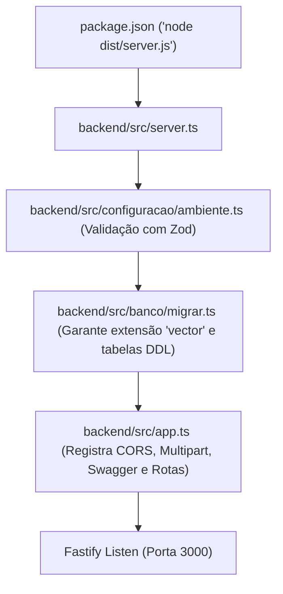
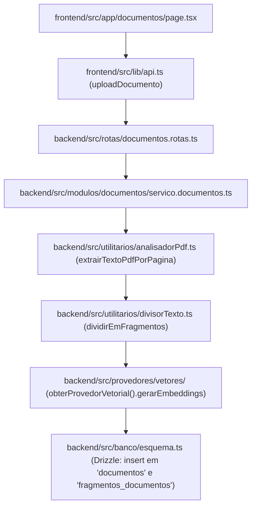
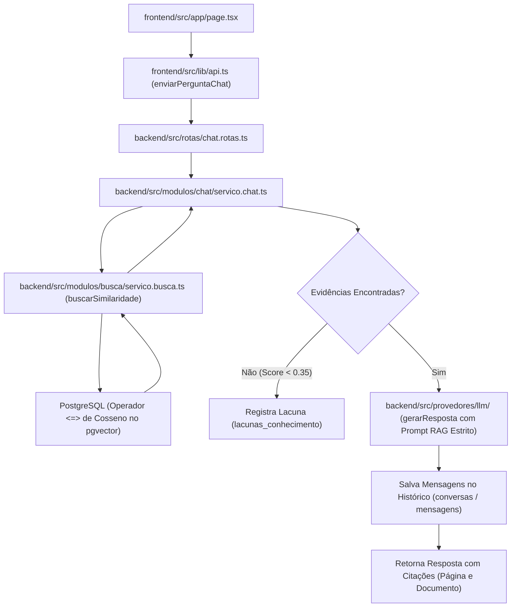
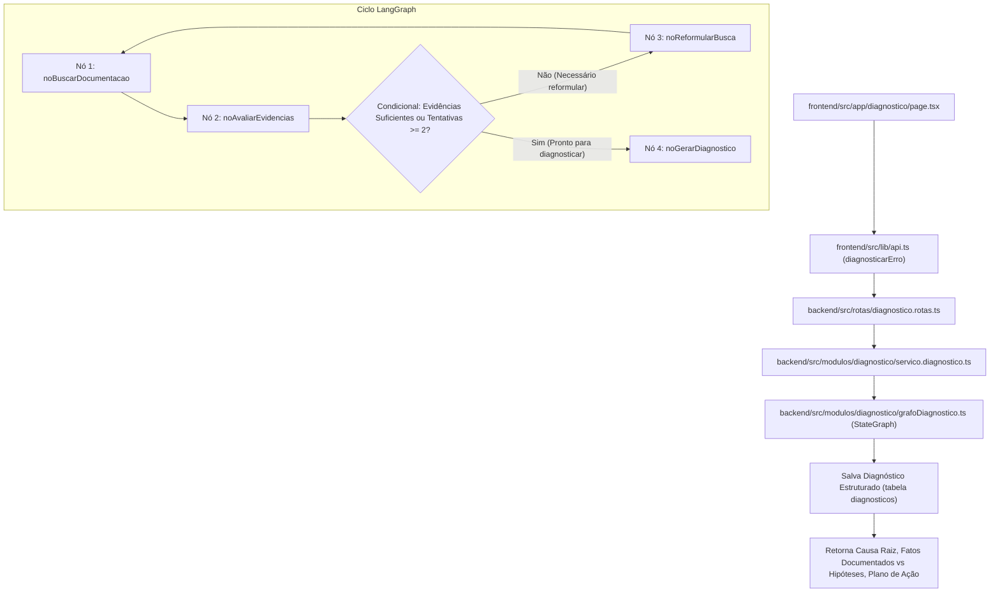

# Mapa de Execução e Arquitetura de Arquivos - Doc-Mind

Este documento é o guia definitivo para entender **como cada arquivo do Doc-Mind é acessado, quem o chama, o que ele executa e como os dados fluem** entre o Frontend (Next.js 14), o Backend (Fastify), o Banco de Dados Vetorial (PostgreSQL + pgvector) e os Agentes Autônomos (LangGraph).

---

## 1. Visão Geral da Estrutura

```text
doc-mind/
├── backend/                     # API REST, RAG e Orquestração com LangGraph
│   ├── src/
│   │   ├── banco/               # Conexão Drizzle ORM, Schemas e Migrações pgvector
│   │   ├── configuracao/        # Validação estrita de variáveis de ambiente (Zod)
│   │   ├── modulos/             # Regras de negócio desacopladas
│   │   │   ├── busca/           # Pesquisa híbrida (Similaridade de Cosseno + Full-Text)
│   │   │   ├── chat/            # RAG conversacional com histórico e fontes
│   │   │   ├── diagnostico/     # Grafo cíclico com LangGraph para análise de erros
│   │   │   ├── documentos/      # Ingestão e pipeline de processamento de PDFs
│   │   │   └── metricas/        # KPIs de confiabilidade e lacunas de conhecimento
│   │   ├── provedores/          # Fábricas para LLM e Vetores (Gemini, OpenAI, Simulado)
│   │   ├── rotas/               # Controladores HTTP (Fastify)
│   │   ├── utilitarios/         # Parser de PDF e divisor de texto em janelas
│   │   ├── app.ts               # Montagem de plugins, CORS, Swagger e rotas
│   │   └── server.ts            # Ponto de entrada (Entrypoint) do servidor Node.js
│   ├── .env                     # Variáveis de ambiente do backend
│   ├── package.json             # Dependências e scripts do backend
│   └── tsconfig.json            # Configuração TypeScript do backend
│
├── frontend/                    # Interface Web Moderna (Next.js 14 App Router)
│   ├── src/
│   │   ├── app/                 # Páginas da aplicação
│   │   │   ├── layout.tsx       # Shell com barra lateral e status do sistema
│   │   │   ├── page.tsx         # Chat RAG interativo
│   │   │   ├── diagnostico/     # Painel de diagnóstico autônomo com LangGraph
│   │   │   ├── documentos/      # Upload e listagem de manuais técnicos
│   │   │   ├── busca/           # Pesquisa técnica com pontuação de relevância
│   │   │   └── metricas/        # Dashboard de KPIs e resolução de lacunas
│   │   ├── componentes/         # Componentes reutilizáveis (Sidebar, StatusPill)
│   │   └── lib/
│   │       ├── api.ts           # Cliente HTTP centralizado (fetch para o backend)
│   │       └── tipos.ts         # Tipos TypeScript compartilhados na UI
│   ├── .env.local               # Variáveis de ambiente do frontend
│   └── package.json             # Dependências e scripts do frontend
│
├── docker/                      # Infraestrutura de banco de dados
│   └── docker-compose.yml       # PostgreSQL 16 com extensão pgvector oficial
│
└── docs/                        # Documentação técnica e arquitetural
```

---

## 2. Mapa dos Ciclos de Execução (Fluxos Ponta a Ponta)

### Fluxo 1: Inicialização do Servidor (Bootstrapping)

Quando você executa `npm run dev:backend` ou `npm start`:



1. **`server.ts`**: Ponto de entrada. Carrega o `ambiente.ts`, valida se as variáveis obrigatórias existem no `.env`.
2. Executa `executarMigracoes()` de `banco/migrar.ts` para garantir que o PostgreSQL tenha as tabelas (`documentos`, `fragmentos_documentos`, `conversas`, `mensagens`, `diagnosticos`, `lacunas_conhecimento`) e os índices HNSW para vetores.
3. Cria a instância de Fastify via `criarAplicativo()` em `app.ts` e inicia o listener na porta configurada.

---

### Fluxo 2: Ingestão de Manuais Técnicos (Upload de PDF)

Quando um operador envia um manual técnico via UI ou `POST /api/v1/documentos/upload`:



1. **Interface**: O usuário anexa um arquivo `.pdf` informando `sistema`, `modulo` e `versao`.
2. **`documentos.rotas.ts`**: Recebe o multipart file em memória (Buffer).
3. **`servico.documentos.ts`**:
   - Salva o registro mestre na tabela `documentos` com status `processando`.
   - Chama `analisadorPdf.ts` que decompõe o PDF preservando os números das páginas.
   - Chama `divisorTexto.ts` para particionar cada página em pedaços de ~800 caracteres com sobreposição de 150 caracteres.
   - Chama o provedor vetorial (`provedores/vetores`) gerando embeddings de 768 dimensões.
   - Insere todos os fragmentos em lote na tabela `fragmentos_documentos` do PostgreSQL.
   - Atualiza o documento mestre para status `processado`.

---

### Fluxo 3: Chat RAG Conversacional com Citações

Quando um usuário faz uma pergunta no chat (`POST /api/v1/chat`):



1. **`chat.rotas.ts`**: Valida a requisição com schema Zod.
2. **`servico.chat.ts`**:
   - Cria ou recupera a conversa ativa.
   - Salva a pergunta do usuário na tabela `mensagens`.
   - Chama `servico.busca.ts`, que gera o embedding da pergunta e executa a busca de similaridade de cosseno (`<=>`) no pgvector filtrando por sistema e versão.
   - **Guardrail de Lacuna**: Se a maior similaridade for inferior ao limiar de corte (0.35), registra automaticamente uma `lacuna_conhecimento` para o time técnico documentar e responde educadamente que a informação não consta nos manuais.
   - **Augmentação de Contexto**: Se houver fragmentos, monta o prompt com instruções estritas para citar o manual e a página.
   - **Geração**: O modelo LLM (`provedores/llm`) sintetiza a resposta final fundamentada.
   - Salva a resposta no banco e devolve à interface com a lista de fontes.

---

### Fluxo 4: Grafo Autônomo de Diagnóstico de Erros (LangGraph)

Quando um analista submete um erro para investigação (`POST /api/v1/diagnostico`):



1. **`grafoDiagnostico.ts`**: Cria um grafo de estados (`StateGraph`) compilado com nós especializados:
   - **`noBuscarDocumentacao`**: Extrai termos-chave do erro e consulta a base de manuais via busca híbrida.
   - **`noAvaliarEvidencias`**: O LLM atua como juiz técnico: avalia se os trechos encontrados explicam a causa raiz do erro.
   - **Borda Condicional (`rotearAposAvaliacao`)**: Se a evidência for insuficiente e o número de tentativas for menor que 2, desvia para `noReformularBusca`, que gera novas palavras-chave e reexecuta o ciclo.
   - **`noGerarDiagnostico`**: Produz um JSON estrito distinguindo **Fatos Documentados** de **Hipóteses**, com passos corretivos imediatos.
2. O resultado é persistido na tabela `diagnosticos` e retornado com métricas de confiança.

---

## 3. Tabela de Referência Rápida: Arquivo por Arquivo

### Backend (`backend/src/`)

| Arquivo | Responsabilidade | Quem o chama / importa? | O que ele consome? |
| :--- | :--- | :--- | :--- |
| `server.ts` | Ponto de entrada do processo Node.js; orquestra subida do banco e da API. | `npm run dev` / `node dist/server.js` | `configuracao/ambiente.ts`, `banco/migrar.ts`, `app.ts` |
| `app.ts` | Configura Fastify, CORS, multipart para uploads, Swagger OpenAPI e rotas. | `server.ts`, testes | Fastify, plugins, e todas as pastas em `rotas/` |
| `configuracao/ambiente.ts` | Valida variáveis do arquivo `.env` com Zod (PORTA, DATABASE_URL, etc.). | Toda a aplicação | `dotenv`, `zod` |
| `banco/index.ts` | Cria a conexão singleton com PostgreSQL via `pg.Pool` e o client Drizzle. | Serviços de negócio e migração | `pg`, `drizzle-orm/node-postgres`, `esquema.ts` |
| `banco/esquema.ts` | Define as tabelas e tipos (`vector(768)`) do Drizzle ORM em português. | `banco/index.ts`, todos os serviços | `drizzle-orm/pg-core` |
| `banco/migrar.ts` | Script idempotente de migração DDL (`CREATE EXTENSION vector`, tabelas e índices). | `server.ts`, `npm run migrar` | `banco/index.ts`, `pg` |
| `rotas/documentos.rotas.ts` | Endpoints REST para upload, listagem e exclusão de manuais técnicos. | `app.ts` | `modulos/documentos/servico.documentos.ts` |
| `rotas/chat.rotas.ts` | Endpoints REST para perguntas RAG e histórico de conversas. | `app.ts` | `modulos/chat/servico.chat.ts` |
| `rotas/busca.rotas.ts` | Endpoint REST para pesquisa técnica híbrida. | `app.ts` | `modulos/busca/servico.busca.ts` |
| `rotas/diagnostico.rotas.ts` | Endpoint REST para execução do diagnóstico autônomo. | `app.ts` | `modulos/diagnostico/servico.diagnostico.ts` |
| `rotas/metricas.rotas.ts` | Endpoints REST para visualização de KPIs e lacunas de conhecimento. | `app.ts` | `modulos/metricas/servico.metricas.ts` |
| `modulos/documentos/servico.documentos.ts` | Pipeline de ingestão: extrai páginas de PDFs, divide em fragmentos e salva vetores. | `documentos.rotas.ts` | `analisadorPdf.ts`, `divisorTexto.ts`, `provedores/vetores`, `banco/` |
| `modulos/chat/servico.chat.ts` | Orquestração RAG conversacional: busca vetorial, verificação de lacunas e LLM. | `chat.rotas.ts` | `servico.busca.ts`, `provedores/llm`, `banco/` |
| `modulos/busca/servico.busca.ts` | Motor de busca vetorial (`<=>` pgvector) e busca híbrida com normalização. | `servico.chat.ts`, `grafoDiagnostico.ts`, `busca.rotas.ts` | `banco/`, `provedores/vetores` |
| `modulos/diagnostico/servico.diagnostico.ts` | Wrapper que dispara a execução do grafo de diagnóstico e salva o histórico. | `diagnostico.rotas.ts` | `grafoDiagnostico.ts`, `banco/` |
| `modulos/diagnostico/grafoDiagnostico.ts` | Definição da máquina de estados LangGraph (`StateGraph`, nós, bordas condicionais). | `servico.diagnostico.ts` | `@langchain/langgraph`, `provedores/llm`, `servico.busca.ts` |
| `modulos/metricas/servico.metricas.ts` | Consultas analíticas SQL para precisão, total de documentos e lacunas abertas. | `metricas.rotas.ts` | `banco/` |
| `provedores/vetores/index.ts` | Fábrica singleton para geração de embeddings (Gemini, OpenAI ou Simulado). | `servico.documentos.ts`, `servico.busca.ts` | Provedores específicos (`simulado.ts`, `gemini.ts`, `openai.ts`) |
| `provedores/llm/index.ts` | Fábrica singleton para inferência de linguagem (Gemini, OpenAI ou Simulado). | `servico.chat.ts`, `grafoDiagnostico.ts` | Provedores específicos (`simulado.ts`, `gemini.ts`, `openai.ts`) |
| `utilitarios/analisadorPdf.ts` | Extração de texto preservando metadados de página via `pdf-parse`. | `servico.documentos.ts` | `pdf-parse` |
| `utilitarios/divisorTexto.ts` | Segmentação de texto com janela deslizante e sobreposição (chunking). | `servico.documentos.ts` | Lógica algorítmica pura |

---

### Frontend (`frontend/src/`)

| Arquivo | Responsabilidade | Quem o chama / exibe? | O que ele consome? |
| :--- | :--- | :--- | :--- |
| `app/layout.tsx` | Layout raiz com menu de navegação, status do backend e container principal. | Next.js App Router | `componentes/BarraLateral.tsx`, `componentes/StatusPill.tsx` |
| `app/page.tsx` | Tela principal: Assistente de Chat RAG com histórico e fontes citadas. | Rota `/` | `lib/api.ts` (`enviarPerguntaChat`), Lucide Icons |
| `app/documentos/page.tsx` | Gerenciamento de Manuais: upload com progresso e listagem tabular. | Rota `/documentos` | `lib/api.ts` (`listarDocumentos`, `uploadDocumento`, `excluirDocumento`) |
| `app/busca/page.tsx` | Ferramenta de busca técnica e inspeção de fragmentos e similaridade. | Rota `/busca` | `lib/api.ts` (`executarBuscaHibrida`) |
| `app/diagnostico/page.tsx` | Painel de investigação autônoma de erros e logs com LangGraph. | Rota `/diagnostico` | `lib/api.ts` (`diagnosticarErro`) |
| `app/metricas/page.tsx` | Dashboard de governança: taxas de precisão, lacunas e botão de resolução. | Rota `/metricas` | `lib/api.ts` (`obterVisaoGeralMetricas`, `obterLacunasConhecimento`) |
| `lib/api.ts` | Camada de abstração HTTP (`fetch`) que conversa com a API Fastify. | Todas as páginas do Next.js | `process.env.NEXT_PUBLIC_URL_API`, `tipos.ts` |
| `lib/tipos.ts` | Interfaces TypeScript compartilhadas pela interface. | Todas as páginas e `lib/api.ts` | Tipagem pura |

---

## 4. Como Adicionar Novas Funcionalidades

1. **Para adicionar um novo endpoint:**
   - Crie a regra no serviço dentro de `backend/src/modulos/<modulo>/servico.<modulo>.ts`.
   - Crie a rota no controller em `backend/src/rotas/<modulo>.rotas.ts`.
   - Registre a rota no `backend/src/app.ts`.
   - Adicione o método cliente em `frontend/src/lib/api.ts`.
   - Construa a tela ou componente em `frontend/src/app/`.

2. **Para alterar o modelo de IA ou Embeddings:**
   - Altere as variáveis `PROVEDOR_LLM` e `PROVEDOR_VETOR` no seu `.env` para `gemini`, `openai` ou `simulado`.
   - Nenhuma linha de código precisa ser alterada: a fábrica desacoplada em `provedores/` faz a alternância transparente.
