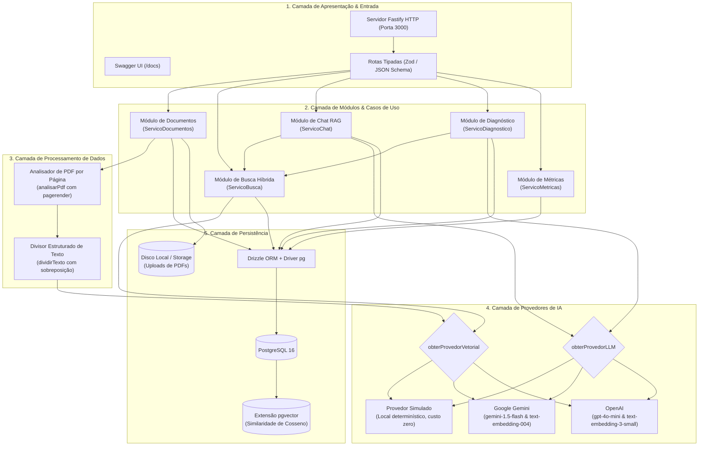
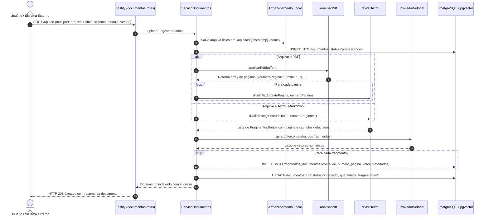
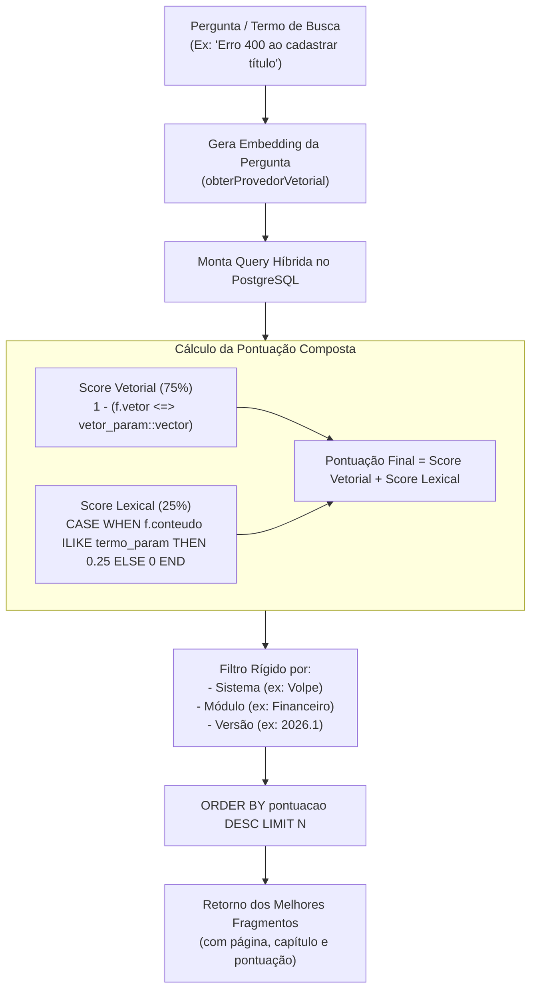
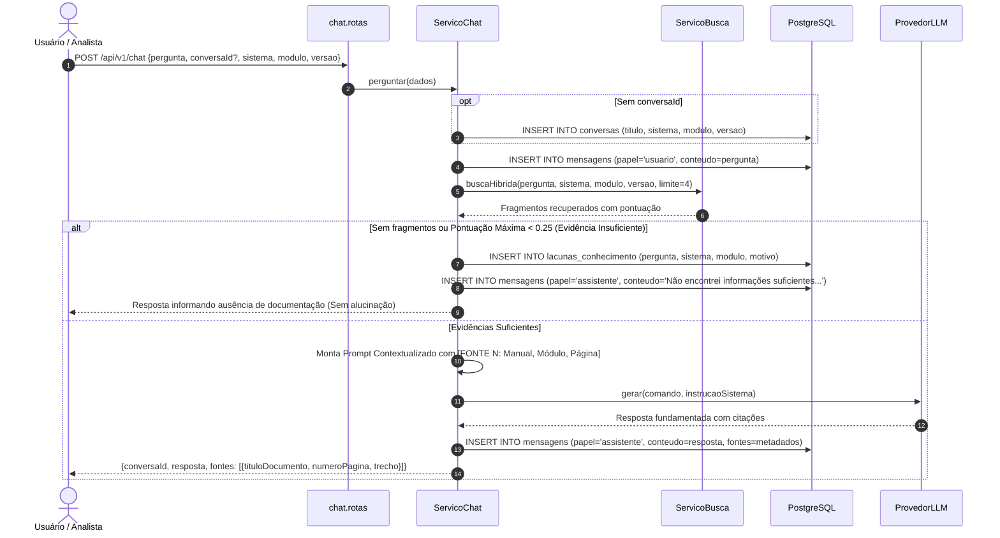
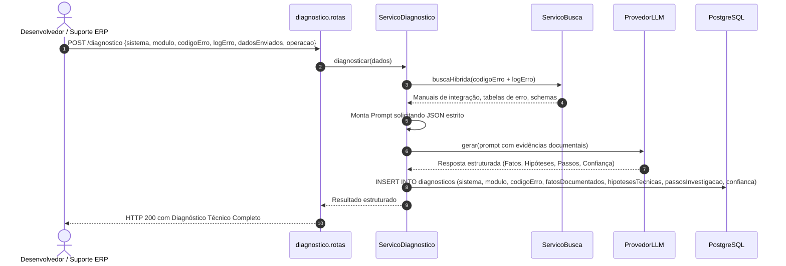
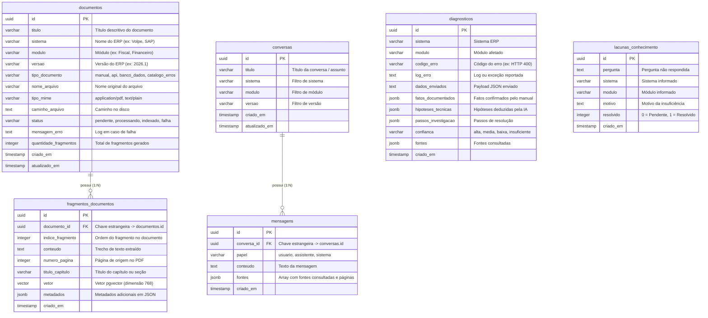

# 📘 Mapeamento e Arquitetura Completa do Sistema — DocMind

> **Documento Oficial de Engenharia, Fluxos de Dados e Funcionamento Interno (100% em Português)**

---

## 1. Visão Geral e Princípios Fundamentais

O **DocMind** é uma plataforma backend corporativa em **TypeScript** projetada para indexar, consultar e analisar documentações técnicas e manuais operacionais de sistemas ERP (como Volpe, SAP, TOTVS, etc.).

Todo o código-fonte, tabelas do banco de dados, variáveis e endpoints foram projetados em **Português**, adotando o paradigma **Headless / API-First**: não possui interface gráfica acoplada. Sua interação se dá integralmente via **REST API** e documentação interativa **OpenAPI/Swagger (`/docs`)**.

### Os 4 Pilares do DocMind

```
┌────────────────────────────────────────────────────────────────────────┐
│                        PILAR 1: ISOLAMENTO                             │
│ Cada manual é rotulado por Sistema, Módulo e Versão (ex: Volpe 2026.1). │
│ Respostas nunca misturam regras de versões diferentes.                │
├────────────────────────────────────────────────────────────────────────┤
│                     PILAR 2: ZERO ALUCINAÇÃO                           │
│ A IA responde estritamente com base nos trechos recuperados.           │
│ Se a informação não constar, a IA admite e cria uma Lacuna.            │
├────────────────────────────────────────────────────────────────────────┤
│                     PILAR 3: RASTREABILIDADE TOTAL                     │
│ Cada resposta cita o Manual de origem, capítulo e número da página.    │
├────────────────────────────────────────────────────────────────────────┤
│                     PILAR 4: DIAGNÓSTICO ESTRUTURADO                   │
│ Separação rígida entre FATOS DOCUMENTADOS e HIPÓTESES TÉCNICAS.        │
└────────────────────────────────────────────────────────────────────────┘
```

---

## 2. Diagrama de Componentes e Camadas



---

## 3. Mapeamento dos Fluxos Operacionais

### Fluxo 1: Ingestão e Processamento de Documentos

**Endpoint:** `POST /api/v1/documentos/upload`  
**Objetivo:** Receber manuais em PDF, TXT ou MD, extrair o texto preservando a numeração de páginas, gerar fragmentos com sobreposição contextual, calcular vetores de embedding e persistir tudo no PostgreSQL.



---

### Fluxo 2: Motor de Busca Técnica Híbrida

**Endpoint:** `POST /api/v1/busca/hibrida`  
**Objetivo:** Recuperar trechos combinando a precisão semântica (vetores) com a exatidão textual (palavras-chave, códigos de erro e nomes de tabelas SQL).



---

### Fluxo 3: Ciclo de Pergunta e Resposta RAG (Anti-Alucinação)

**Endpoint:** `POST /api/v1/chat`  
**Objetivo:** Responder a dúvidas dos usuários fundamentando cada afirmação em trechos comprovados dos manuais e registrando lacunas caso a documentação seja omissa.



---

### Fluxo 4: Diagnóstico Guiado de Erros e Logs

**Endpoint:** `POST /api/v1/diagnostico`  
**Objetivo:** Receber uma mensagem de erro, stack trace, código de retorno e payload enviado, correlacionar com a base de conhecimento e gerar um diagnóstico estruturado.



---

## 4. Modelagem do Banco de Dados (ERD em Português)



---

## 5. Catálogo Completo de Endpoints REST (Português)

| Método | Rota | Descrição | Parâmetros Principais |
|---|---|---|---|
| `GET` | `/saude` | Verificação de conectividade com banco e provedores | N/A |
| `GET` | `/docs` | Documentação interativa Swagger UI | N/A |
| `POST` | `/api/v1/documentos/upload` | Ingestão e indexação de novo manual/documento | Form multipart: `file`, `titulo`, `sistema`, `modulo`, `versao`, `tipoDocumento` |
| `GET` | `/api/v1/documentos` | Listagem de documentos cadastrados com filtros | Query: `sistema`, `modulo`, `versao` |
| `GET` | `/api/v1/documentos/:id` | Retorna metadados e todos os fragmentos de um manual | Param: `id` (UUID) |
| `DELETE` | `/api/v1/documentos/:id` | Exclui arquivo físico e remove fragmentos do banco | Param: `id` (UUID) |
| `POST` | `/api/v1/busca/hibrida` | Busca combinada por similaridade de cosseno e texto | Body: `{ termoBusca, sistema, modulo, versao, limite }` |
| `POST` | `/api/v1/chat` | Chat RAG fundamentado com fontes e citações | Body: `{ pergunta, conversaId, sistema, modulo, versao }` |
| `GET` | `/api/v1/chat/:conversaId/historico` | Recupera todas as mensagens de uma conversa | Param: `conversaId` (UUID) |
| `POST` | `/api/v1/diagnostico` | Diagnóstico técnico de logs, payloads e erros de ERP | Body: `{ sistema, modulo, codigoErro, logErro, dadosEnviados, operacao }` |
| `GET` | `/api/v1/metricas/visao-geral` | Estatísticas gerais de documentos e fragmentos | N/A |
| `GET` | `/api/v1/metricas/lacunas` | Relatório de perguntas sem resposta suficiente | Query: `resolvido` (boolean) |
| `PATCH` | `/api/v1/metricas/lacunas/:id/resolver` | Marca uma lacuna como atendida após atualização do manual | Param: `id` (UUID) |
